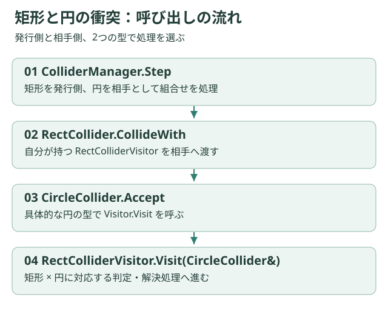

# ダブルディスパッチとVisitor

## 2つの形状から処理を選ぶ



衝突は「自分」と「相手」の形状で処理が変わります。現行コードは発行側が持つVisitorを、相手のAcceptへ渡します。

```text
ColliderManager::Step
  → 発行側.CollideWith(相手)
  → 相手.Accept(発行側のVisitor)
  → Visitor.Visit(具体的な相手の形状)
  → 判定・Resolver・接触イベント
```

例えばRectColliderはRectColliderVisitorを持ち、相手が円ならCircleCollider側のAcceptから`Visit(CircleCollider&)`へ進みます。仮想関数とオーバーロードを組み合わせ、発行側と相手側の型に応じた処理を選ぶため、ダブルディスパッチとして説明できます。

## 判定と解決を分ける

Colliderは形状や移動量、Visitorは組合せごとの進行、Resolverは押し戻しや接触情報を扱います。新しい形状ではVisitorの受け口と組合せの実装も必要です。クラスを1つ追加するだけで全組合せに対応するわけではありません。

## タイルは方向が重要

TileColliderのAcceptは空で、TileColliderVisitorから矩形へ訪問する形です。地形側のマスク設定が必要です。円対タイルは空実装なので、円形キャラクターを地形へ追加する教材例には使えません。

すり抜け対策にはswept形状やサブステップがありますが、あらゆる速度での完全な連続衝突検出を保証しません。トリガー条件の不一致も[制約](../project/status.md)に記載しています。

[Collision API](../api/collision.md) · [衝突実習](../tutorials/collision.md)
