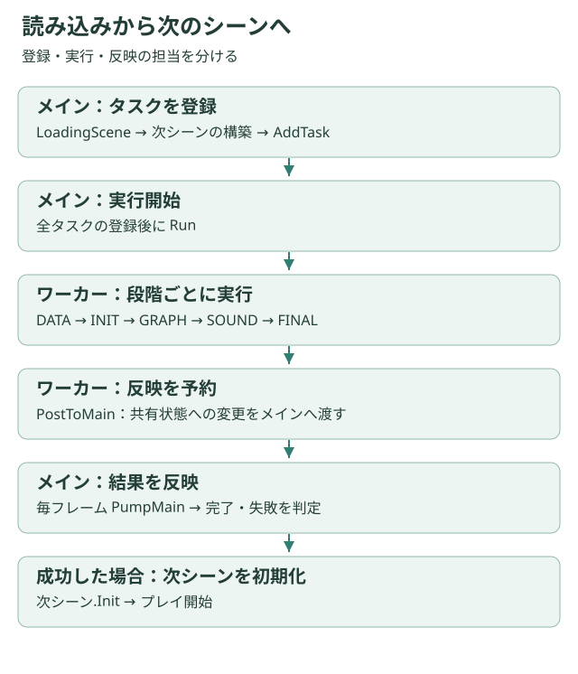

# 非同期読み込みとタスク管理

## 処理の流れ



```text
メイン：LoadingScene構築 → Loading有効化 → 次シーン構築・タスク登録 → Run
ワーカー：DATA → INIT → GRAPH → SOUND → FINAL（同一段階は並列）
ワーカー：結果をPostToMainへ予約
メイン：毎フレームPumpMain → 完了・失敗判定 → 次シーンInit
```

DxLibの非同期読み込みと、自作Loadingのタスク実行は別の層です。画像・音声はDxLibに開始を依頼し、タスクで完了確認を行う経路があります。コルーチンは待機状態を記述する仕組みで、コルーチンそのものが別スレッドを作るわけではありません。

## PR #35の変更

以前はタスク追加時点で実行していました。変更後はAddTaskが登録のみ、Runが実行開始を担当します。全タスクが揃う前に段階の完了判断へ進む構造を見直しています。

GraphやSoundでは、ワーカーが共有コンテナーを直接変更する経路を、PostToMainで予約してメインスレッドへ反映する方式へ変更しています。MapとTileColliderも一時データを構築してから反映します。

読み込み開始失敗や非同期ハンドルのエラーを扱い、失敗通知とタイトル復帰／終了経路を用意しています。これは失敗経路を追加した事実であり、全例外への対応完了を意味しません。

## 呼び出し側の契約

AddTaskはメインスレッドでRun前に呼びます。LoadingContextはthread_localなので、ワーカーから必要なLoading*は明示的に捕捉します。共有状態の変更はPumpMainで反映し、対象オブジェクトは完了まで生存させます。

進捗は処理バイト数や残り時間ではなくタスク数です。失敗・スキップも終了数に入ります。コンテキスト外のAsync関数は同期的に実行されることがあります。

制限付きスレッドプール、強制キャンセル、タイムアウト、同一Loadingの繰り返し実行は完成済みの機能として扱いません。

[Loading API](../api/mylib.md) · [PR #35](https://github.com/SyuLin1167/2DGameSample/pull/35)
