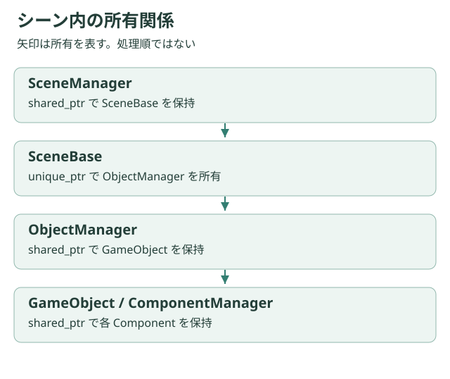

# オブジェクトの所有権と寿命

## 誰が破棄するか

| 対象 | 主な所有・参照 |
| --- | --- |
| SceneBase | SceneManagerのshared_ptr。LoadingSceneが旧・次シーンを一時保持 |
| ObjectManager | SceneBaseのunique_ptr |
| GameObject | ObjectManager内のshared_ptr |
| Component | ComponentManager内のshared_ptr。所有者は生ポインタで参照 |
| Collider | シーンのColliderManager内のunique_ptr |
| UI要素 | 共有UIManager内のunique_ptr |
| アセット管理クラス | AssetManager内のunique_ptr |
| カメラ対象 | 座標への生ポインタ。破棄前に解除が必要 |

shared_ptrは「何でも安全にする型」ではありません。外部保持でGameObjectがシーンより長生きすると、借用しているColliderManagerが先に消える可能性があります。

## シーン単位の管理

ObjectManagerはColliderManagerをオブジェクト群より前に宣言します。メンバーは逆順で破棄されるため、オブジェクトのデストラクターがコライダーをDestroyする間、管理側を生存させられます。これは宣言順を含む契約です。

## 世代付きID

ColliderIDとUIElementIDはスロット番号と世代で識別します。破棄時にaliveをfalseにし世代を進め、古いIDを拒否します。世代が上限に達したスロットは退役させ、桁あふれで古いIDが再び一致することを避けます。

ただしIDに管理インスタンスの識別子はないため、別シーンのIDとの混同までは防ぎません。取得した生ポインタもDestroy後には使えません。

## 非同期処理との関係

Loadingの破棄は実行中ワーカーの終了を待ちます。タスクが捕捉したthisや反映先を先に破棄しないことが必要です。イベントのlambdaが捕捉したthisも同様で、イベントやUIの解除と所有者の破棄を揃えます。

[Object API](../api/object.md) · [UI API](../api/ui.md) · [非同期設計](./loading.md)
