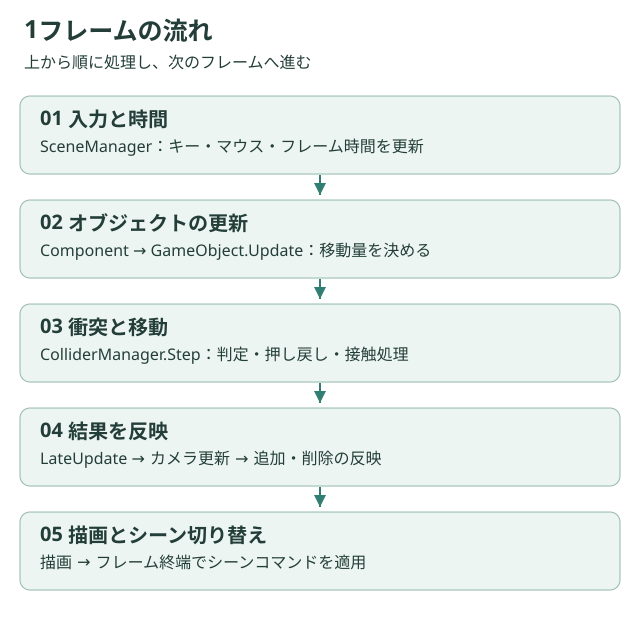

# 更新と寿命

## 1フレームの流れ

1. `SceneManager`がフレーム時間、キー、マウスを更新します。
2. 現在のシーンの`Update()`を呼びます。
3. Playでは`ObjectManager::Update()`が各オブジェクトのComponent、`Update()`を実行します。
4. `ColliderManager::Step()`が衝突処理と移動を行います。
5. 各オブジェクトの`LateUpdate()`、カメラ更新、追加・削除の反映を行います。
6. 描画し、フレーム終端でシーンコマンドを適用します。

Playerは`Update()`でコライダーへ移動量を渡し、`LateUpdate()`で解決後の座標を戻します。コライダーを持つオブジェクトで座標を二重に進めないよう注意してください。

## 生成と初期化

`AddObject`は所属するColliderManagerを設定し、`OnAttach()`を呼びます。その後、シーンの`Init()`から`InitBeforeUpdate()`を呼ぶとオブジェクトの参照取得と`Init()`が実行されます。ローディングでは先にコンストラクターでタスクを登録し、完了後に次シーンの`Init()`へ進みます。

更新中に追加したオブジェクトは一時保存され、更新後に`Init()`されます。この経路は通常の`InitBeforeUpdate()`と完全に同じではなく、`GetReferenceObject()`は呼びません。

## 破棄

オブジェクトは自分のコライダーを破棄し、カメラへ登録した座標参照を解除します。`ObjectManager`内ではオブジェクト群の後にColliderManagerが破棄される宣言順です。

外部へ持ち出した`shared_ptr<GameObject>`がシーンより長生きすると、この前提を崩せます。Componentも所有者への生ポインタを持つため、シーン外に保持しないでください。

## 更新順の制約

タグ間の順序は`OBJECT_TAGS`、同じタグ内は配列の順序です。一方、Componentの格納先は`unordered_map`なので、追加順の更新は保証されません。複数Componentが同じ座標・移動量を上書きする設計では競合を整理してください。

関連：[Object API](../api/object.md)、[シーン実習](../tutorials/scene.md)
