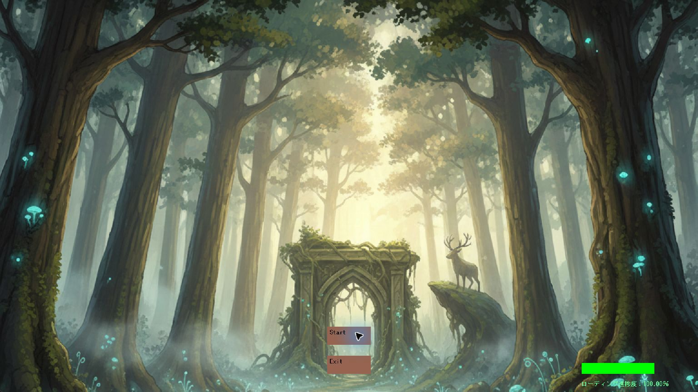
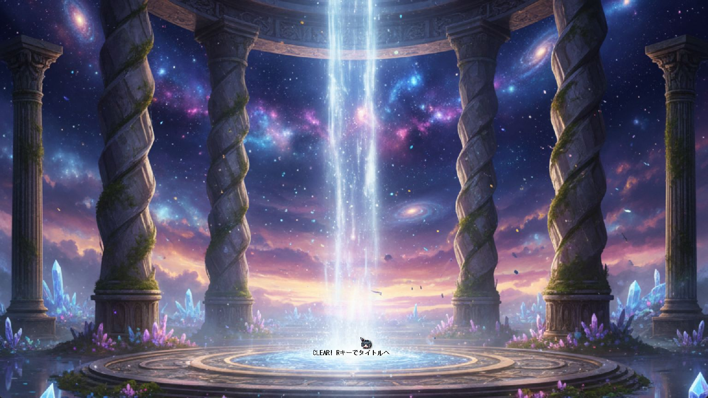

# 掲載素材の準備

## 必要な素材

| 素材 | 内容・用途 | 状態 |
| --- | --- | --- |
| プレイ画面1枚 | Player・地形・GOALが分かる画面。READMEの代表画像 | 未撮影 |
| タイトル画面 | Start／Exitを含む。導入確認に使用 | 2026-10-13撮影済み |
| クリア画面 | CLEAR表示とタイトルへの案内 | 2026-10-13撮影済み |
| 30〜60秒の動画 | タイトル→移動・ジャンプ→ゴール→Result | 未撮影 |
| 読み込みの画面 | 進捗表示の説明。実際の状態を記録 | 未撮影 |

現在のREADMEにあった外部添付画像は、現行版との一致と掲載条件を確認できていないため再利用していません。

## 撮影時に確認すること

### 取得済みの画面

撮影日：2026-10-13。既存の`ProjectName/x64/Release/project.exe`（更新日時：2026-10-12）を使用しました。今回再ビルドしていないため、実行ファイルの対応コミットは未確認です。ゲームウィンドウのみを取得し、デスクトップやローカルパスは含めていません。タイトル画面には実際のロード進捗表示が残っています。背景・音声などの掲載条件は引き続き確認が必要です。

タイトル画面と結果画面の表示を確認した記録であり、移動・ジャンプ・音声・ゴール判定全体の動作検証を示すものではありません。動画は未収録です。

撮影コミット、ビルド構成、日時を記録します。動画はゲーム音を含む場合の掲載条件も確認します。デスクトップ、ユーザー名、通知、ローカルパス、デバッグ用ログが入らないようゲーム画面を切り出します。

確認済み画像は`docs/public/media/`へ配置し、代替テキストを付けます。動画は容量と公開範囲を確認してから掲載先を決めます。未撮影の画像を完成画面として生成・掲載しません。
